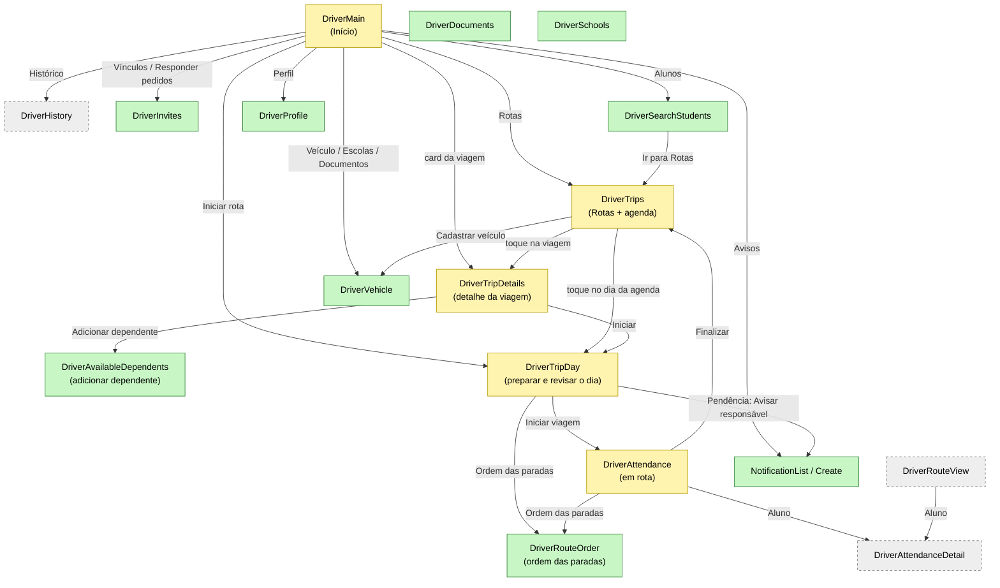
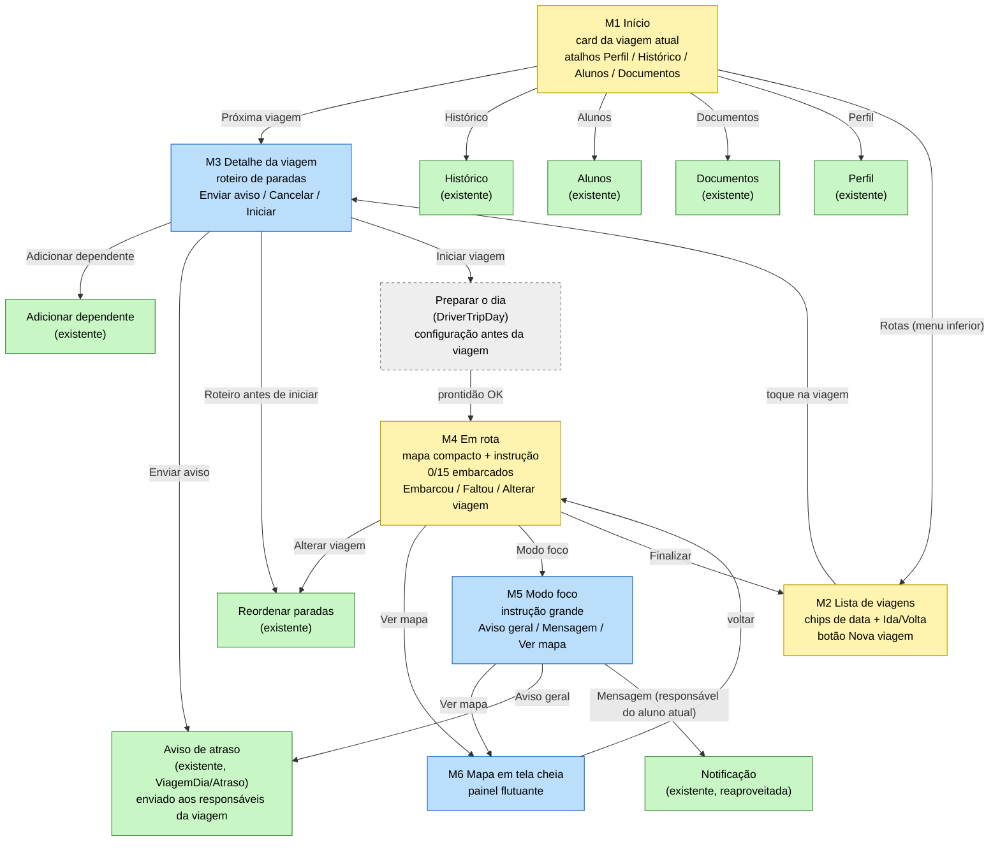

# Fluxo das telas do Motorista: hoje x proposto

Referência: `figma_proposta_ajuste_telas.jpeg` (seção "06 · Fluxos de Telas"). Este documento complementa [Redesenho_telas_motorista.md](./Redesenho_telas_motorista.md).

Escopo fora desta análise, conforme decisão: Responsável (R1/R2), card 3D do veículo, clima, provedor de rota (Google Directions) e Flyway.

Legenda dos diagramas:
- Nó **verde**: tela que já existe e continua igual
- Nó **amarelo**: tela existente que será reformada
- Nó **azul**: tela nova (não existe hoje)
- Nó **cinza tracejado**: tela fora do mockup, a confirmar

---

## 1. Hoje

Navegação atual, com base nos `navigate(...)` de `frontendreact/src/screens/`.

Observações do estado atual:
- A tela de **Início** tem 9 atalhos (Rotas, Alunos, Vínculos, Histórico, Veículo, Escolas, Documentos, Avisos, Perfil). O mockup pede 4 atalhos (Perfil, Histórico, Alunos, Documentos).
- A execução passa por **DriverTripDay** antes da **DriverAttendance**. O mockup não mostra essa etapa.
- Não existe tela de modo foco nem de mapa em tela cheia.

---

## 2. Proposto

Fluxo derivado do mockup (M1 a M6).

---

## 3. Comparativo por tela

| Tela | Hoje | Proposto | Ação |
|---|---|---|---|
| Início (M1) | 9 atalhos, card "Em rota" ou viagens ativas | 4 atalhos, card da viagem atual | **Reformar** `DriverMainScreen.tsx` |
| Lista de viagens (M2) | Agenda 7 dias, filtro Ida/Volta/Todos, modal de criar | Chips de data, Ida/Volta, "Nova viagem" | **Reformar** `DriverTripsScreen.tsx` |
| Detalhe da viagem (M3) | Nome, dependentes, desativar, iniciar | Roteiro de paradas, Enviar aviso, Cancelar, Iniciar | **Reformar** `DriverTripDetailsScreen.tsx`, com nova seção de roteiro |
| Preparar o dia (DriverTripDay) | Prontidão, pendências, consentimento GPS, iniciar | Configuração da viagem antes de iniciar, entrada por "Iniciar viagem" no M3 | **Manter** e ajustar a entrada |
| Em rota (M4) | Mapa de 180px, progresso, Finalizar, Avisar atraso, Alterar ordem | Mapa compacto, instrução, Embarcou/Faltou, Alterar viagem | **Reformar** `DriverAttendanceScreen.tsx` |
| Modo foco (M5) | Não existe | Instrução grande, Aviso geral, Mensagem, Ver mapa | **Criar** |
| Mapa tela cheia (M6) | Não existe | Mapa com painel flutuante | **Criar** (com `TripMap.tsx` e `TripMap.web.tsx`) |
| Ordem das paradas, detalhe do aluno, histórico, documentos, veículo, escolas, convites, perfil | Existem | Não aparecem no mockup | **Manter** sem mudança por ora |

---

## 4. Telas que ficam sem acesso com a Home reduzida

A Home passa a ter 4 atalhos: Perfil, Histórico, Alunos e Documentos. Abaixo, o que deixa de ter entrada pela Home e se ainda há outra forma de chegar lá. Verificado no código: nenhuma tela ficou inalcançável.

| Tela | Acesso hoje | Acesso depois da mudança | Situação |
|---|---|---|---|
| Rotas (`DriverTrips`) | Atalho na Home | Menu inferior (lista de viagens) | Continua acessível |
| Vínculos (`DriverInvites`) | Atalho na Home e card "Responder pedidos" | Menu inferior (aba "Vínculos") e card "Responder pedidos" | Continua acessível |
| Veículo (`DriverVehicle`) | Atalho na Home, card "Em rota" sem veículo, "Cadastrar veículo" em Rotas, pendência em "Preparar o dia" | Perfil, item "Meu veículo" | Continua acessível |
| Escolas (`DriverSchools` e detalhe vínculo) | Atalho na Home | Perfil, item "Minhas escolas" | Continua acessível |
| Avisos (`NotificationList`) | Atalho na Home | Sino no cabeçalho | Continua acessível |

Como nenhuma tela ficou sem acesso, não há novo ponto de entrada obrigatório. A seção "Cadastros" em Perfil continua registrada como item relatado, sem implementação nesta entrega.

---

## 5. Respostas de validação

1. **Atalhos da Home**: reduzir para 4, com a tabela da seção 4 como referência.
2. **Preparar o dia**: é a tela de configuração da viagem do dia. Acontece antes de a viagem começar. Fluxo: M3 "Iniciar viagem" abre a configuração, e quando a prontidão está OK entra no em rota (M4).
3. **Reordenar paradas**: a tela é aberta de dois pontos.
   - M4, pelo botão "Alterar viagem".
   - M3, ao tocar no card do roteiro antes de iniciar a viagem.
4. **Aviso geral**: é o aviso de atraso que já existe, enviado a todos os responsáveis dos dependentes da viagem. Reaproveita `ViagemDia/{id}/Atraso`. Não é notificação nova.
5. **Telas fora do mockup**: detalhe do aluno e histórico de execução continuam como estão.

**Avisos**: "Enviar aviso" (M3) e "Aviso geral" (M5) são a mesma ação por enquanto, o aviso de atraso para todos os responsáveis da viagem (`ViagemDia/{id}/Atraso`). Ambos seguem para o atraso no fluxo.

**Mensagem** (M5) é diferente. É uma notificação específica para o responsável do aluno que está na tela naquele momento. Usa `Notificacao` com `dependente_id` preenchido.

